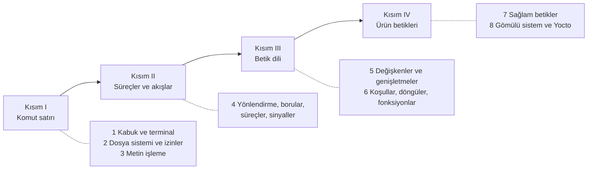

# Linux Komut Satırı ve Bash

**Kabuk, metin işleme araçları ve sağlam Bash betikleri üzerine, gömülü Linux ve Yocto bağlamında
açık kaynak Türkçe kitap.**

Gömülü Linux geliştiricisinin günü komut satırında geçer: derleme makinesinde BitBake çıktıları süzülür,
günlükler incelenir, imajlar hazırlanır; hedef cihazda seri konsoldan BusyBox kabuğuyla sorun aranır;
CI hattında derlemeyi çalıştıran betikler yazılır. Bu kitap, bu işlerin dayandığı temel beceriyi
**derinlemesine** öğretir. Her konu "ne, neden, nasıl çalışır" sırasıyla ele alınır; komutların
arkasındaki işleyiş (dosya tanımlayıcıları, fork/exec, genişletme sırası, `set -e` istisnaları)
animasyonlu şemalarla gösterilir ve terminal oturumlarındaki tüm çıktılar komutlar gerçekten
çalıştırılarak elde edilmiştir.

## Hedef kitle

- Gömülü Linux ve Yocto ile çalışmaya başlayan yazılım ve donanım mühendisleri
- Komut satırını kullanan, ancak betiklerinin neden bazen sessizce hata verdiğini anlamak isteyen geliştiriciler
- Yocto tariflerindeki kabuk görevlerini, init betiklerini ve CI betiklerini bakımını üstlenen ekipler
- Gömülü sistemler ve işletim sistemleri derslerinde uygulama çalışması arayan öğretim üyeleri ve öğrenciler

Ön koşul olarak bir Linux sistemine (yerel kurulum, sanal makine, WSL veya kapsayıcı) erişim ve temel
bilgisayar kullanımı yeterlidir. Yocto'ya değinilen bölümler için
<a href="../yocto-gomulu-linux/index.html">Yocto Project ile Gömülü Linux</a> kitabının ilk altı
bölümünün okunmuş olması yararlıdır, ancak zorunlu değildir.

## Kitabın yapısı

| Bölüm | Kapsam |
|---|---|
| [1 · Kabuk, terminal ve komutların yapısı](bolumler/01-kabuk-ve-terminal.md) | Terminal, sözde terminal, satır disiplini; komut türleri ve arama sırası, PATH ve hash, yardım kaynakları, geçmiş ve tamamlama |
| [2 · Dosya sistemi, izinler ve kullanıcılar](bolumler/02-dosya-sistemi-izinler.md) | FHS ve gömülü kök dosya sistemi, inode ve bağlantılar, izin bitleri, umask, setuid ve yapışkan bit, sudo, Yocto'da sahiplik |
| [3 · Metin işleme](bolumler/03-metin-isleme.md) | BRE/ERE, grep, sed'in desen alanı ve adresleme, awk alanları ve ilişkisel diziler, find ölçütleri, <code>-print0 &#124; xargs -0</code>, BitBake çıktısı analizi |
| [4 · Yönlendirme, borular, süreçler ve sinyaller](bolumler/04-yonlendirme-surecler.md) | fd tablosu, yönlendirme sırası, here-doc, borular ve SIGPIPE, PIPESTATUS, fork/exec/wait, iş denetimi, sinyaller, nohup |
| [5 · Bash betiklerine giriş](bolumler/05-betik-temelleri.md) | Shebang, değişkenler, export ve ortam, tırnaklar, genişletme sırası, parametre genişletme, aritmetik, BitBake ve kabuk değişkenleri |
| [6 · Koşullar, döngüler, diziler ve fonksiyonlar](bolumler/06-kosul-dongu-fonksiyon.md) | `[ ]`, `[[ ]]`, `(( ))`, case, döngüler, `while read`, borudaki alt kabuk, diziler, fonksiyon kapsamı |
| [7 · Sağlam betikler](bolumler/07-saglam-betikler.md) | `set -euo pipefail` ve tuzakları, trap, mktemp, getopts, kilit dosyası, ShellCheck, POSIX sh ve taşınabilirlik |
| [8 · Gömülü sistemlerde ve Yocto'da kabuk betikleri](bolumler/08-gomulu-betikler.md) | BusyBox ash, init betikleri, systemd ile ilişki, BitBake kabuk görevleri ve `run.do_*`, `pkg_postinst`, CI betikleri |

Her bölüm öğrenme hedefleriyle başlar; kavramsal anlatım, animasyonlu şemalar, terminal oturumları,
uygulama çalışmaları, özet, etkileşimli değerlendirme soruları ve çözümlü bir alıştırmayla biter.
Tüm animasyonlar ve oturumlar [Animasyonlu şemalar](araclar/animasyonlar.md) sayfasında da toplanmıştır.

## Örnek proje

Kitaplığın tüm kitaplarında olduğu gibi örnekler, ekransız bir **endüstriyel sensör ağ geçidi**
üzerinden ilerler. Ürünün dağıtımı **ÖrnekOS**, Yocto katmanı `meta-ornek`, cihazın adı `agecidi`'dir.
Bu kitapta ağ geçidinin günlüklerini çözümleyen araçlar (`sensor-ozet.awk`, `sensor-rapor.sh`),
yapılandırma yedekleyen sağlam bir betik (`yedekle.sh`), sensörü izleyen bir servis (`sensor-izle`)
ve onun init betiği, systemd birimi ve Yocto tarifi ile bir CI derleme betiği (`ci-derle.sh`)
geliştirilir. Kodların tamamı depodaki `examples/` dizinindedir ve her biri ShellCheck'ten geçirilip
çalıştırılarak denenmiştir.

Terminal oturumlarında iki istem kullanılır: `kullanici@agecidi:~$` hedef cihaz veya genel kullanım
için, `gelistirici@derleme:~$` Yocto derleme makinesi için. Oturumlar Ubuntu 24.04 üzerinde
**bash 5.2**, **dash 0.5.12**, **BusyBox 1.36.1**, GNU coreutils 9.4, GNU grep 3.11, GNU sed 4.9,
gawk 5.2 ve ShellCheck 0.11 ile kaydedilmiştir; sürüme bağlı davranışlar metinde belirtilmiştir.
Yocto'ya ilişkin bilgiler Yocto Project 6.0 *Wrynose* sürümünü esas alır.

## Kitaplıktaki yeri

Bu kitap, Gömülü Linux Kitaplığı'nın temel beceri kitaplarından biridir ve diğer kitaplarla şu
noktalarda birleşir:

- <a href="../yocto-gomulu-linux/index.html">Yocto Project ile Gömülü Linux</a>: tariflerdeki kabuk
  görevleri, `run.do_*` ve `log.do_*` dosyaları, kurulum sonrası betikler ve CI (Bölüm 5, 8).
- <a href="../git-surum-kontrolu/index.html">Git ile Sürüm Kontrolü</a>: komut satırı ve borular
  git'in günlük kullanımının temelidir; betiklerin depoda ShellCheck ile denetlenmesi.
- <a href="../c-derleme/index.html">C, Make ve CMake ile Derleme</a>: Makefile tariflerindeki kabuk satırları,
  SDK ortam betiğinin kaynaklanması ve çapraz derleme değişkenleri (Bölüm 5).
- <a href="../python-gomulu/index.html">Gömülü Geliştirici için Python</a>: kabuk betiğinin yetmediği
  durumlarda Python'a geçiş ve `subprocess` ile süreç yönetimi.
- <a href="../cekirdek-onyukleme/index.html">Linux Çekirdeği ve Önyükleme</a>: init sistemleri, seri konsol,
  `/proc` ve `/sys` arayüzleri (Bölüm 2, 4, 8).

## Okuma önerileri

- **Komut satırına yeni başlayanlar:** [Kitabın kullanımı](nasil-okunur.md) → Bölüm 1'den itibaren sırayla
- **Betik yazanlar:** Bölüm 4, 5 ve 7 (özellikle 7.2 `set -e` istisnaları)
- **Yocto ile çalışanlar:** Bölüm 3.8, 5.8 ve 8
- **Hızlı başvuru:** [Komut özeti](ekler/komut-ozeti.md) ve [Terimler sözlüğü](ekler/sozluk.md)

## Lisans ve katkı

Bu kitap açık kaynaklı bir topluluk çalışmasıdır. Metin
[CC BY-SA 4.0](https://creativecommons.org/licenses/by-sa/4.0/deed.tr), örnek kodlar MIT lisansıyla
yayımlanır. Düzeltme ve katkı önerileri her sayfanın üstündeki :material-file-edit-outline: düğmesiyle
iletilebilir.

<small>Linux, Linus Torvalds'ın tescilli markasıdır. Yocto Project, Linux Foundation'ın tescilli
markasıdır. Bu kitap bağımsız bir topluluk çalışmasıdır; adı geçen projeler tarafından yayımlanmamış
veya onaylanmamıştır.</small>
